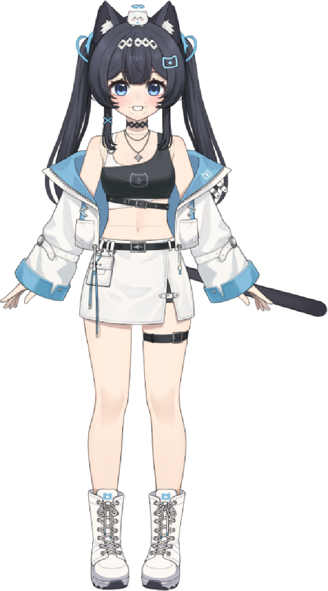

# YUI

This is yumeFriend's bundled dark-themed default Live2D model.

It is the **YUI** Live2D model from
[Project-N-E-K-O/N.E.K.O](https://github.com/Project-N-E-K-O/N.E.K.O),
published as part of that Apache-2.0 repository.

The model has:

- 261 parameters and 30 parameter groups
- 26 expression entries and 40 motion3 files
- built-in Idle, happy, sad, angry, neutral and surprised motion groups
- a 4096 x 4096 runtime atlas

License and attribution:

- [`LICENSE`](LICENSE)
- [`NOTICE`](NOTICE)
- [`PROVENANCE.md`](PROVENANCE.md)

This is the only Live2D model bundled with the repository and release package.
The user's local Big Fish model stays under `user_data/live2d/` and is never
included in the release zip.
